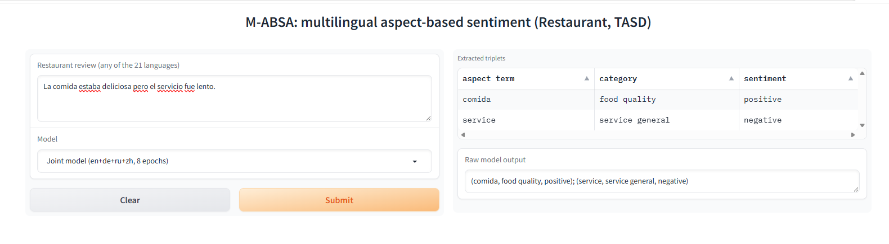

# M-ABSA reimplementation and improvements (Restaurant, TASD)

Reproduction of the mT5-base baseline of **M-ABSA** (Wu et al., EMNLP 2025, multilingual aspect-based sentiment analysis, 21 languages) on the **Restaurant** domain, plus four improvement experiments and a Gradio demo.
Official code and data: https://github.com/swaggy66/M-ABSA

All results: single seed (42), Restaurant domain only. The paper averages 5 seeds over 7 domains.

## Results (official fixed F1, %)

English baseline: **65.61** (paper 66.34). Average over 21 languages: **39.33** (paper 43.40).

Average over the 17 languages the joint model never saw (zero-shot):

| Setting | Avg F1 |
|---|---|
| Baseline (English-trained) | 37.55 |
| Paper (same 17 languages) | 41.22 |
| Exp 1: copy-constrained decoding | 40.45 |
| Exp 3: joint training (en+de+ru+zh, 8 epochs) | 48.11 |
| Exp 4: joint + copy-constrained decoding | 49.78 |

Exp 2 (translate-train, supervised, not comparable with the paper): de 59.26, es 61.22.
Per-language tables are in `results/`.

## Experiments

1. **Copy-constrained decoding**: aspect terms may only use text found in the input sentence (`COPY_CONSTRAINT=1`).
2. **Translate-train**: train on a language's own translated data (de, es).
3. **Joint multilingual training**: en+de+ru+zh, 8 epochs.
4. **Joint model + copy-constrained decoding.**

## Changes to the official code (`src/`)

- `num_workers=0` (DataLoader deadlock on Windows).
- Strict scorer (deduplicated) printed next to the official scorer. The official scorer counts repeated predictions as true positives.
- `save_top_k=1`, `save_weights_only=True`, plus an extra save of the last-epoch weights (named `cktepoch=30.ckpt` even for shorter runs).
- Tolerant label parsing for lines with apostrophes inside aspect terms.
- Dump of all predictions to JSON.
- Optional copy-constrained decoding via environment variables.

## Setup

Python 3.8. Install PyTorch from its index, then the rest:

```
pip install torch==1.7.1+cu110 -f https://download.pytorch.org/whl/cu110/torch_stable.html
pip install -r requirements.txt
```

Also needs `six` and `setuptools==59.5.0`. Put the official repo in `third_party/M-ABSA`, download `google/mt5-base` into `eval_baseline_mT5/mT5-base`, and copy the files from `src/` over the originals in `eval_baseline_mT5/`. Data goes in `data/tasd/restaurant/<lang>/`

Create an empty `results_log` folder before running (the code does not create it).

## Demo

`python app/app.py` (Gradio). Model checkpoints (about 2.2 GB each) are not in this repo.



## Technical report

https://drive.google.com/file/d/1Q7LZ6ec_gpZAkTNSh5SMRQnaGoS0rCMd/view?usp=sharing. 
